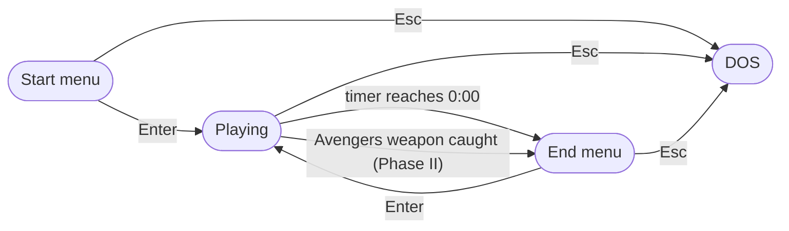

<div align="center">

# 🧤 INFINITY RUSH

### Catch the stones. Dodge the Avengers. Beat the clock.

A falling-object catching game written entirely in **x86 assembly** — VGA graphics, custom interrupt handlers and hand-drawn pixel art, all in a few kilobytes.


[Overview](#-overview) •
[Gameplay](#-gameplay) •
[Run it](#-build--run) •
[Project structure](#-project-structure) •
[Under the hood](#-under-the-hood) •
[Roadmap](#-roadmap) •
[Team](#-team)

</div>

---

## ✨ Overview

**Infinity Rush** is a Marvel-themed catching game built for the *Computer Organization and Assembly Language* (COAL) course at FAST-NUCES. You control the **Infinity Gauntlet** at the bottom of the screen and collect the **Infinity Stones** before the two-minute round runs out — but catch one of the Avengers' weapons and it's over.

No libraries, no engine: every pixel, every colour, every keystroke and every tick of the clock is handled by our own assembly code running on the 8088 instruction set.

> This is a student project. It is not affiliated with, endorsed by, or sponsored by Marvel or FAST-NUCES.

---

## 🎮 Gameplay

You have **2 minutes**. Catch as much as you can.

### Collect these

| Item | Points |
|:---:|:---:|
| 🔵 **Space** and 🟡 **Mind** stones | **+5** |
| 🔴 **Reality** and 🟣 **Power** stones | **+10** |
| 🟢 **Time** and 🟠 **Soul** stones | **+15** |

### Avoid these

| Item | Result |
|:---:|:---|
| ⚡ **Arc Reactor**, 🛡️ **Shield**, 🔨 **Mjolnir** | **The Avengers win — game over** |

### Controls

| Key | Action |
|:---:|:---|
| <kbd>Enter</kbd> | Start the game / play again |
| <kbd>←</kbd> <kbd>→</kbd> | Move the Gauntlet *(Phase II)* |
| <kbd>Esc</kbd> | Quit to DOS |

### Screens

- **Start menu** — title banner, controls, what to catch and what to avoid
- **Play screen** — night sky with clouds and stars, a lava floor, live timer (`TIME 02:00`) and live score (`SCORE: n`)
- **End menu** — either **TIME'S UP!** or **AVENGERS WIN!**, with your final score

<!--
Add screenshots here once you have them (press Ctrl+F5 inside DOSBox to capture one),
save them in a docs/ folder, then uncomment:

<p align="center">
  
  
  
</p>
-->

---

## 🚀 Build & Run

### What you need

- [**NASM**](https://www.nasm.us/) — the assembler
- [**DOSBox 0.74**](https://www.dosbox.com/) — to run the `.COM` file

### Quick start (prebuilt)

The repository includes a ready-made `INFINITY.COM`. Just run it in DOSBox:

```text
mount c C:\path\to\InfinityRush-COAL
c:
INFINITY.COM
```

### Build from source

```bash
nasm -f bin infinity.asm -o infinity.com
```

Then run it in DOSBox as shown above.

> **Keep all the `.asm` files in the same folder.** `infinity.asm` pulls in the others with `%include`, and the file names are kept to DOS-friendly 8.3 length on purpose.

---

## 🗂️ Project structure

| File | What it does |
|:---|:---|
| `infinity.asm` | **Main program** — setup, main loop and game states, timer and keyboard interrupt handlers, palette, drawing routines (rectangles, sprites, hidden background buffer), clock |
| `gear.asm` | Pixel-art sprites: the Gauntlet and the Avengers weapons (Arc Reactor, Shield, Mjolnir) |
| `stones.asm` | The six Infinity Stone sprites and their name tables |
| `font.asm` | Our own text renderer — draws letters pixel by pixel from the BIOS 8×8 font, with no black box behind them |
| `text.asm` | Text helpers: print a string, print a number, print centred text |
| `screens.asm` | Live score display for the HUD |
| `menus.asm` | The start menu and end menu |
| `banners.asm` | Large pixel-font title banners (`INFINITY RUSH`, `AVENGERS WIN!`, `TIME'S UP!`) |
| `INFINITY.COM` | Prebuilt game |

---

## 🔧 Under the hood

<details>
<summary><b>Game flow</b></summary>



The main loop is a small **state machine**: each pass waits for one timer tick, then does the work for the current state (start, play or ended).

</details>

<details>
<summary><b>Graphics</b></summary>

- **VGA mode 13h** — 320×200 pixels, 256 colours, one byte per pixel at segment `A000h`.
- **Custom palette** — 48 hand-picked colours loaded through VGA ports `3C8h`/`3C9h` (sky gradient, lava, gold, stone colours…).
- **24×24 sprites** — each object fills one 3×3 space of 8×8 cells; colour `0` is transparent.
- **Hidden background buffer** — the whole background is drawn once into a spare 64 KB segment, so a moving sprite can be erased by copying a small square back instead of redrawing the scene.
- **No black boxes** — BIOS text in mode 13h draws a black rectangle behind every letter, so `font.asm` reads the BIOS 8×8 font and plots only the pixels that belong to each letter.

</details>

<details>
<summary><b>Timing & input</b></summary>

- **Timer (INT 8)** — our handler counts ticks and then chains to the original BIOS handler with a far jump. The hardware ticks about **18.2 times per second**, so each tick counts as 10 and **182 = one second**, keeping everything in whole numbers.
- **Keyboard (INT 9)** — our handler reads scancodes from port `60h`, sets a flag for each key (pressed = 1, released = 0), and acknowledges the keyboard and the interrupt controller.
- **Clean exit** — the original interrupt vectors are restored before the program ends.

</details>

<details>
<summary><b>8088 constraints we worked within</b></summary>

- No `pusha` / `popa`, no `push` of an immediate, and shifts only by 1 or by `CL`.
- Screen offset `y × 320 + x` is computed as `(y << 8) + (y << 6) + x`.
- Segment registers are never loaded from constants — values go through a general register.
- Every routine saves and restores the registers it changes.

</details>

---

## 🗺️ Roadmap

### Phase I — Interface & objects &nbsp;✅ *(due 8 Nov 2026)*

- [x] Start screen
- [x] Play screen with Gauntlet and collectible objects
- [x] Infinity Stones
- [x] Two-minute countdown timer
- [x] Live score display
- [x] End screen with final score

### Phase II — Full gameplay &nbsp;🚧 *(due 29 Nov 2026)*

- [ ] Move the Gauntlet with the arrow keys
- [ ] Falling objects
- [ ] Catch detection (collisions)
- [ ] Real scoring: +5 / +10 / +15
- [ ] Game over when an Avengers weapon is caught
- [ ] Polish and final testing

---

## 👥 Team

| | Name | GitHub | Worked on |
|:---:|:---|:---|:---|
| 🧑‍💻 | **Umer Hassan** | [@ShortBatman](https://github.com/ShortBatman) | Program skeleton, graphics core, sprites, timer, keyboard input |
| 👩‍💻 | **Maria Tariq** | [@mariiii-03](https://github.com/mariiii-03) | Text routines, start & end screens, live score, menu design |

---

<div align="center">

*Built with NASM, DOSBox and a lot of `mov`.*

**FAST-NUCES · Computer Organization and Assembly Language**

</div>
